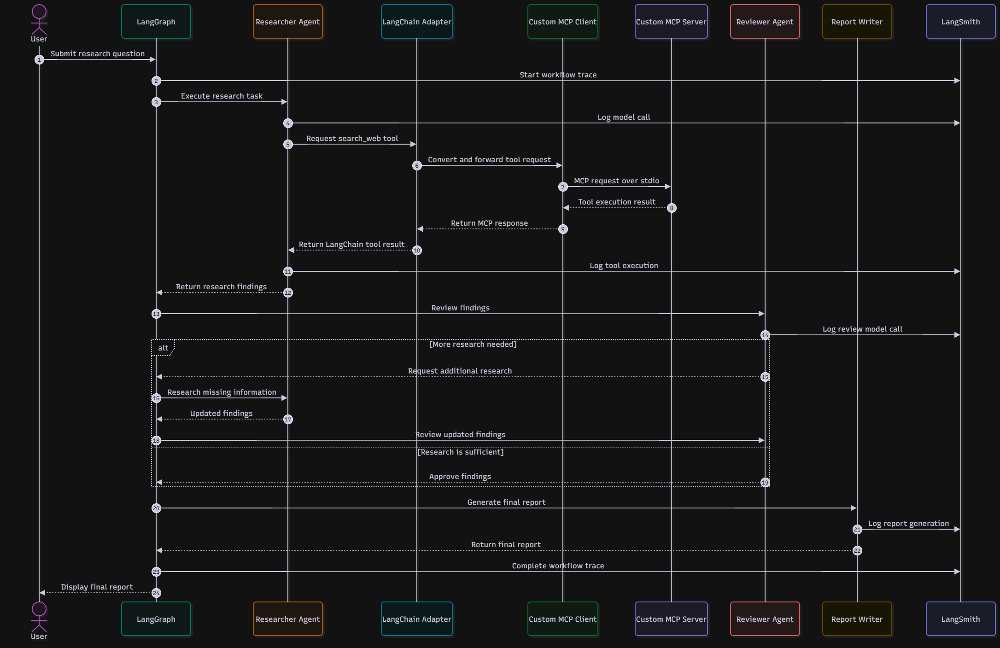

# AI Research Team

An agentic AI application that coordinates specialized AI agents to research a question, review the findings, and produce a final report.

The project explores multi-agent orchestration, the Model Context Protocol (MCP), LangChain tool integration, and LangGraph workflows.

## Architecture



The architecture diagram illustrates the main components and their interactions.

### Architecture resources

- [Architecture documentation](docs/architecture.md)
- [Mermaid source](docs/architecture.mmd)
- [Editable draw.io diagram](docs/architecture.drawio)
- [Architecture image](docs/architecture.png)

## Features

- **Researcher agent:** Gathers findings for a research question.
- **Reviewer agent:** Evaluates research findings and identifies missing information.
- **Report Writer agent:** Produces a final report from the research workflow.
- **MCP integration:** Uses a custom MCP server and client.
- **LangChain adapter:** Converts MCP tools into LangChain-compatible tools.
- **LangGraph orchestration:** Coordinates agent execution and workflow transitions.
- **Bounded retries:** Allows additional research when the reviewer requests it, with a configured retry limit.
- **LLM integration:** Uses Groq for language-model inference.
- **Observability:** Supports LangSmith tracing and debugging when configured.

## Technology Stack

- Python
- Model Context Protocol (MCP)
- LangChain
- LangGraph
- Groq
- LangSmith
- Pytest
- FastAPI (listed as a dependency; API implementation is still pending)

## Project Structure

```text
ai-research-team/
├── docs/
│   ├── architecture.drawio
│   ├── architecture.md
│   ├── architecture.mmd
│   └── architecture.png
├── src/
│   ├── adapters/
│   │   ├── mcp_to_langchain.py
│   │   └── test_adapter.py
│   ├── agents/
│   │   ├── researcher.py
│   │   ├── reviewer.py
│   │   ├── report_writer.py
│   │   ├── workflow.py
│   │   ├── test_researcher.py
│   │   ├── test_reviewer.py
│   │   ├── test_report_writer.py
│   │   ├── test_workflow.py
│   │   ├── test_workflow_integration.py
│   │   └── test_workflow_retries.py
│   ├── api/
│   ├── mcp_client/
│   │   └── client.py
│   └── mcp_server/
│       └── server.py
├── tests/
│   ├── test_mcp_to_langchain.py
│   └── test_workflow_automated.py
├── .env.example
├── .gitignore
├── GIT_COMMIT_CONVENTION.md
├── requirements.txt
└── README.md
```

## How It Works

1. A research question enters the workflow.
2. The Researcher gathers findings.
3. The Reviewer evaluates the findings and checks for missing information.
4. If further research is needed, reviewer feedback is sent back to the Researcher, subject to the retry limit.
5. The Report Writer generates the final report.

## Getting Started

### Prerequisites

- Python
- A Groq API key
- A LangSmith API key if you want to use LangSmith tracing

### 1. Clone the repository

Replace the URL below with your actual GitHub repository URL.

```powershell
git clone YOUR_GITHUB_REPOSITORY_URL
cd ai-research-team
```

### 2. Create and activate a virtual environment

```powershell
python -m venv .venv
.\.venv\Scripts\Activate.ps1
```

### 3. Install dependencies

```powershell
python -m pip install -r requirements.txt
```

### 4. Configure environment variables

Use `.env.example` as a reference to create a local `.env` file. Populate the variables required by the application, including your Groq credentials and any LangSmith settings.

Keep `.env` out of Git. Never publish API keys, tokens, or other secrets.

## Running Tests

Run the automated test suite from the repository root:

```powershell
python -m pytest -v
```

The automated tests cover the MCP-to-LangChain adapter and the LangGraph workflow, including its retry behavior.

## Development Status

The multi-agent workflow, MCP integration, LangChain adapter, architecture documentation, and automated tests are present in the project.

The FastAPI directory is currently empty, so an HTTP API endpoint and deployment instructions remain future work.

## Roadmap

- [ ] Expose the research workflow through FastAPI.
- [ ] Add API-level tests.
- [ ] Deploy the application and verify the live workflow.
- [ ] Document API usage and deployment configuration.
- [ ] Expand automated test coverage.

